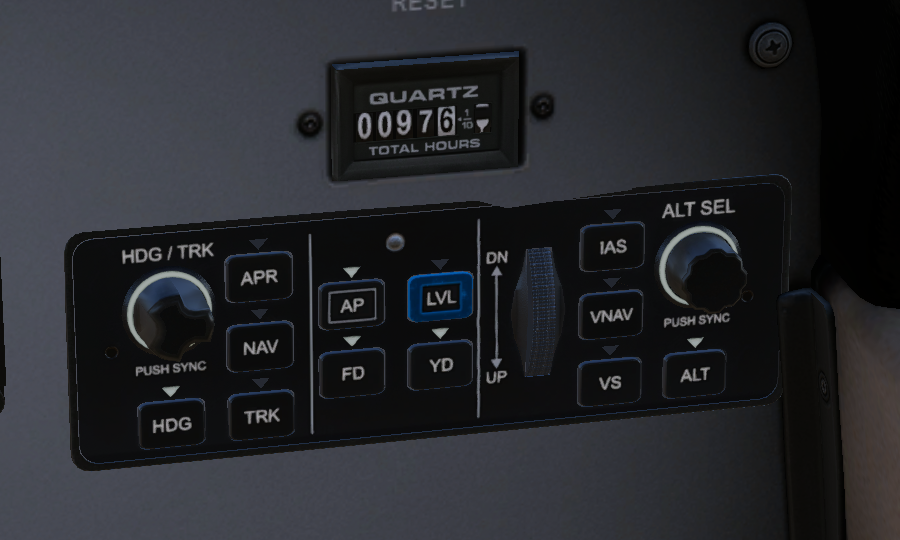
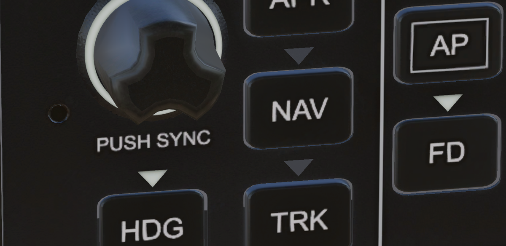
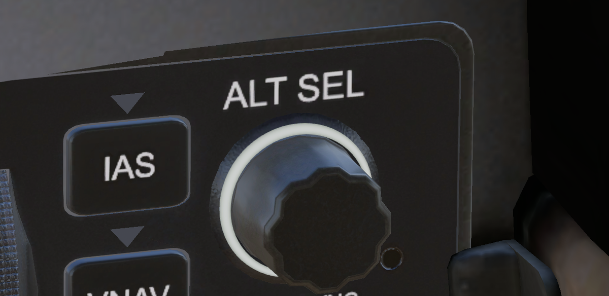
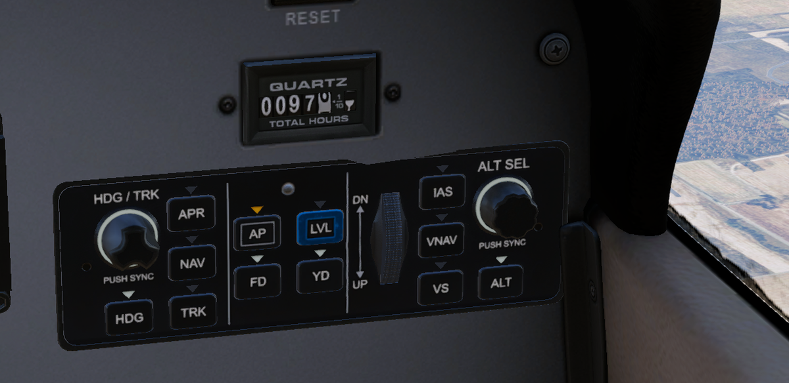
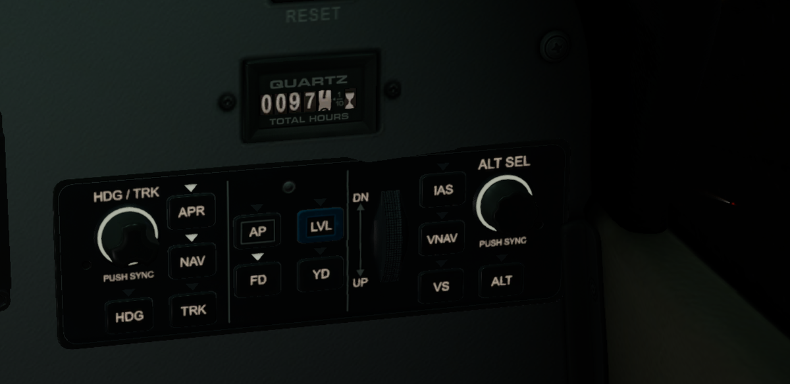
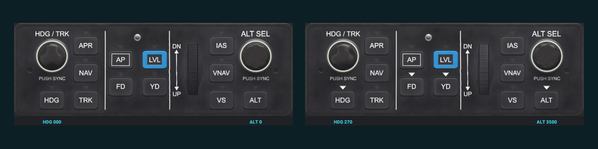

# GMC 507 for X-Plane 12

The Garmin GMC 507 autopilot mode controller, rebuilt for X-Plane 12.

Twelve keys, two knobs and a pitch wheel. No screen, and no autopilot of its own: it drives X-Plane's.

<p align="center"></p>

## A quick look

<table>
<tr>
<td width="50%"><br>
<sub>Click it right in the 3D cockpit. No need to give up your cockpit object for it.</sub></td>
<td width="50%"><br>
<sub>ALT SEL turns 100 ft a click (your call in config.ini). The wheel moves your VS, airspeed or pitch target.</sub></td>
</tr>
<tr>
<td><br>
<sub>Autopilot off? The AP lamp flashes amber, three seconds by default.</sub></td>
<td><br>
<sub>At night the legends, lamps and knob rings follow your panel dimmer.</sub></td>
</tr>
<tr>
<td colspan="2"><br>
<sub>Rather use a pop-up? Same keys, same commands, with heading and altitude on a strip below.</sub></td>
</tr>
</table>

## Read the manual

Everything lives in **[GMC507_Manual.pdf](GMC507_Manual.pdf)**: every key and mode, installing it, every setting,
command and dataref, and where it differs from the real unit.

This README stays short on purpose. One place to update, one place to look.

## What you get

- All twelve keys of the -01 unit: AP, FD, YD, LVL, HDG, TRK, NAV, APR, IAS, VNAV, VS, ALT
- HDG / TRK and ALT SEL knobs with PUSH SYNC, and the NOSE UP / NOSE DN wheel
- Garmin's key rules on top of X-Plane's GFC-700 autopilot: modes only set the flight director, only AP and LVL
  engage the autopilot
- Lamps that show what the autopilot is doing, and the amber flash when it lets go
- The 3D unit and a pop-up, both live, plus 20 commands for your keyboard, joystick or VR controller
- Not tied to one display: anything that shows X-Plane's autopilot will do
- Optional: `AFCS_ESP/`, which adds ESP and the `laminar/afcs/` interface displays can read

## Quick start (aircraft authors)

1. Copy `GMC507/` to `<aircraft>/plugins/xlua/scripts/GMC507/`.
2. In Plane Maker, **Standard > Objects**, add `../plugins/xlua/scripts/GMC507/3D/GMC507.obj` as an ordinary
   object (not the cockpit object). Put its origin about 6 mm behind the panel face and it sits flush.
3. Make sure the aircraft's autopilot uses the GFC-700 logic.
4. Go fly. `laminar/gmc507/popup_toggle` opens the pop-up.

Want ESP too? Copy `AFCS_ESP/` next to it and read [AFCS_ESP/README.md](AFCS_ESP/README.md) first.

**Needs** X-Plane 12 (tested on 12.4.4), and xLua 2 in the aircraft's `plugins/xlua/` (not included; get it from
the [XLua repository](https://github.com/X-Plane/XLua)). Tested on Windows only.

**Don't** install it in an aircraft that already runs Laminar's stock GFC 500 script (`GFC500.System`). Both
create the same commands and datarefs.

Settings live in `GMC507/config.ini`, each one explained in the file. If something does not work, or you need
something it does not do, please open an [Issue](../../issues).

## Under the hood

- Plain xLua 2. Every key, knob and wheel step becomes an X-Plane command; X-Plane's autopilot does the flying.
- X-Plane only clicks the cockpit object, so the 3D unit is clicked by a ray test of our own (`gmc507_pick.lua`).
- The pop-up is a render of the same 3D model, so the two always look alike.
- The lamp white was taken from photos of a real Garmin GFC 700 mode controller.

Behavior follows Garmin's GFC 500 *Flight Manual Supplement* 190-02291-02 Rev 11 and *Maintenance Manual*
190-02291-01 Rev 15.

## Files

```
GMC507/
  GMC507.lua          master script: lifecycle, commands, datarefs, flight loop
  gmc507_logic.lua    everything the keys, knobs, wheel and lamps do
  gmc507_pick.lua     3D clicks
  gmc507_popup.lua    the pop-up
  config.ini          the settings, documented line by line
  gmc507_*.png        the pop-up's face, knobs and lamps
  3D/                 GMC507.obj and its textures
AFCS_ESP/             optional: ESP and the laminar/afcs/ interface
GMC507_Manual.pdf     the manual
docs/gallery/         the pictures above
```

## Credits

GMC 507 for X-Plane, by Tiezheng Eric Xu for Laminar Research. Behavior per Garmin's documents listed above; the
documents are not included.

Garmin, GFC and GMC are trademarks of Garmin Ltd. or its subsidiaries. This project is not affiliated with or
endorsed by Garmin.

## License

MIT; see [LICENSE](LICENSE).
